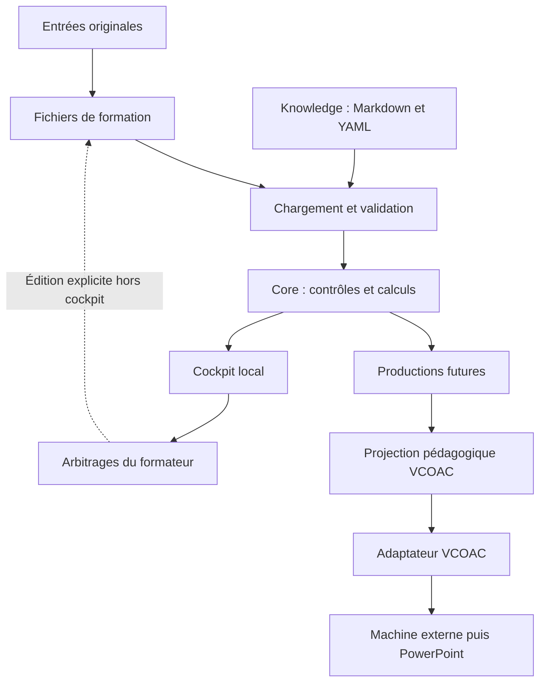

# Hector Studio — Architecture cible

**Statut : proposition soumise à validation humaine avant développement.**

Références lues : `README.md`, `AGENTS.md` et [CAHIER_DES_CHARGES.md](CAHIER_DES_CHARGES.md). Les références `CDC-xx` renvoient à ce dernier. Les identifiants `ARC-xx` et `DEC-xx` servent aux futurs travaux.

Principe : **simple maintenant, extensible lorsque le besoin apparaît**. Cette architecture décrit des responsabilités et des fichiers futurs ; elle ne demande pas de les construire tous dans un même cycle.

## ARC-01 — Périmètre et invariants

Le premier prototype est un cockpit local en **lecture interactive uniquement**, alimenté par les deux scénarios statiques IA017. Il vise à valider l’expérience d’arbitrage avant de développer la persistance. Il fonctionne sans IA intégrée, recherche automatique, connexion Perplexity ni génération PowerPoint (CDC-29 à CDC-31).

La conception pédagogique est conservée dans des fichiers lisibles, modifiables humainement et versionnés. Le cockpit et les futures productions consomment cette même source. Aucun export, cache d’affichage ou PowerPoint ne la remplace (CDC-20, CDC-24).

Le modèle pédagogique VCOAC appartient au domaine pédagogique ; la machine PowerPoint VCOAC est un consommateur externe, accessible seulement par un adaptateur (CDC-10, CDC-25).

La portée détaillée d’une V1 plus large reste à arbitrer. Les composants différés sont décrits uniquement pour préserver ces frontières.

## ARC-02 — Décisions d’architecture

| ID | Décision proposée | Justification et référence | Alternative écartée pour V1 |
| --- | --- | --- | --- |
| DEC-01 | JSON pour les données structurées d’une formation ; Markdown pour les contenus longs. | Lecture directe, différences Git lisibles, validation et consommation par le cockpit (CDC-24, CDC-27). | Tout en Markdown obligerait à interpréter la prose ; YAML seul ajouterait un parseur aux données principales. |
| DEC-02 | Un `formation.json` par scénario comme colonne vertébrale structurée ; des Markdown référencés pour les contenus riches ou longs. | Conserver identifiants, métadonnées, états, décisions, hypothèses, structures, relations et contenus courts ensemble (CDC-07 à CDC-14, CDC-24). | Un fichier par petite entité multiplierait les manipulations ; accumuler les contenus riches dans le JSON le rendrait lourd. |
| DEC-03 | HTML, CSS et JavaScript en modules natifs ; un processus Node.js local pour charger, valider et servir les données. | Les neuf vues et la navigation ne justifient pas un framework ; un seul langage couvre affichage et contrôles (CDC-23, CDC-27). | React ou une application à framework complet n’apportent pas de bénéfice démontré à ce stade. |
| DEC-04 | JSON Schema 2020-12, validation par Ajv côté Node.js, puis contrôles de cohérence. | Distinguer structure correcte et cohérence pédagogique (CDC-07 à CDC-10, CDC-28). | Des validations artisanales dispersées ou un schéma SQL rendraient le contrat plus fragile. |
| DEC-05 | Notes Markdown avec métadonnées YAML simples dans les dossiers actuels de `knowledge/`. | Réutilisation, traçabilité et compatibilité Obsidian (CDC-15 à CDC-21). | Neo4j, stockage vectoriel ou format propriétaire sont prématurés. |
| DEC-06 | Deux fixtures IA017 complètes et indépendantes, partageant seulement les entrées explicitement référencées. | Tester le programme seul et le contexte Act-On Data sans mélange implicite (CDC-29). | Un système d’héritage entre scénarios masquerait les différences et compliquerait les tests. |
| DEC-07 | Lecture HTTP locale et interactions UX sans sauvegarde depuis le cockpit ; les fichiers restent la source de vérité. | Valider l’expérience d’arbitrage avant la persistance, avec un comportement explicite au rechargement (CDC-23, CDC-24). | Une copie métier persistante dans le navigateur, `localStorage` ou un fichier propre au cockpit créerait une seconde vérité. |
| DEC-08 | Adaptateur `adapters/vcoac/` recevant une formation validée et sa projection pédagogique. | Isoler le contrat de la machine et ses contraintes graphiques (CDC-25). | Appeler les composeurs JS depuis le cœur couplerait pédagogie et PowerPoint. |
| DEC-09 | Exigences métier dans la documentation ; contrôles métier explicites dans `core/rules/` ; arbitrages dans la formation. | Préserver la distinction entre faits, hypothèses, recommandations et choix humains (CDC-02, CDC-18). | Des règles cachées dans les vues ou des seuils inventés ne seraient pas vérifiables. |
| DEC-10 | Calculs génériques déterministes dans `core/calculs/`, sans accès aux fichiers ni à l’interface. | Réutiliser et tester les calculs de temps, couverture et dépendances (CDC-06, CDC-08, CDC-28). | Dupliquer ces calculs dans chaque écran ou export produirait des résultats divergents. |

## ARC-03 — Couches et circulation générale



La flèche des arbitrages vers les fichiers représente une édition explicite hors cockpit, par le formateur ou par Codex à sa demande. Les actions UX du premier prototype restent temporaires et ne déclenchent aucune écriture dans les fichiers.

| Couche | Responsabilité | Frontière |
| --- | --- | --- |
| Inputs | Conserver programme, demande libre, compte rendu, compléments et recherches existantes ; identifier leur provenance. | Une entrée reste une pièce d’origine, pas une décision pédagogique. |
| Core pédagogique | Exploiter cadrage, hypothèses, personas, programme, gap, situations, compétences, dépendances, modules, VCOAC, activités, outils, preuves et alertes. | Aucun DOM, fournisseur de recherche ou composeur PowerPoint dans les règles. |
| Source de vérité | Porter les données structurées, décisions et contenus de la formation. | Les données calculées sont reproductibles et ne sont pas saisies en double. |
| Knowledge | Conserver les connaissances réutilisables et leurs sources. | Pas de copie de chaque formation entière dans la base de connaissances. |
| Cockpit | Rendre les choix, relations et alertes compréhensibles pour arbitrer. | Aucun modèle métier propre à l’interface. |
| Research Router | Orienter ultérieurement une recherche vers un fournisseur disponible. | Interface conceptuelle seulement en V1. |
| Production | Consommer une même représentation validée pour chaque sortie. | Aucun retour automatique d’un export vers la source. |
| Adaptateur VCOAC | Traduire vers le contrat de la machine externe. | Les contraintes graphiques restent à cette frontière. |

Le couplage repose sur des objets JSON, des identifiants stables et des fonctions ordinaires. Aucun bus de messages, microservice, système de plugins ou base de données n’est nécessaire.

## ARC-04 — Source de vérité concrète

### ARC-04.1 — Fichiers d’une formation

La source de vérité est un **ensemble de fichiers faisant autorité**, dont `formation.json` reste le fichier principal de chaque scénario en V1. Il constitue la **colonne vertébrale structurée de la formation**, et non un conteneur destiné à accumuler les contenus longs.

Il contient prioritairement les identifiants, métadonnées, états, décisions, hypothèses, structures, relations, contenus courts et références vers d’autres ressources.

**Principe : `formation.json = colonne vertébrale` ; `Markdown = contenu riche`.**

Les recherches détaillées, fiches conceptuelles, cas complets, corrigés détaillés, exemples longs et ressources documentaires peuvent être externalisés en Markdown et référencés depuis `formation.json`. Les contenus propres au scénario restent dans `contenus/` ; les connaissances réutilisables vont dans les dossiers existants de `knowledge/`. Cette répartition n’ajoute pas de couche technique à la V1.

| Fichier futur | Responsabilité |
| --- | --- |
| `formation.json` | Colonne vertébrale : identifiants, métadonnées, états, structures, relations, décisions, hypothèses, contenus courts et références. |
| `contenus/ACT-001.md` | Consignes, correction, exemple de production et variantes d’une activité ; les sections sont référencées par ancre. |
| `contenus/KIT-001.md` | Explication, exemple rempli, template vierge et conseils d’un kit spécifique à cette formation. |
| Documents de `inputs/` | Originaux conservés, ou transcription fidèle explicitement identifiée avec sa provenance. |
| Notes référencées de `knowledge/` | Concepts, méthodes, outils, cas et sources réutilisables ; leur contenu n’est pas recopié dans le JSON. |

Créer les contenus seulement lorsqu’ils sont utiles. Aucun fichier spécialisé par persona, compétence ou module n’est nécessaire au premier prototype. Un découpage supplémentaire devra répondre à une difficulté constatée de lecture ou de modification.

### ARC-04.2 — Contenu proposé de `formation.json`

Les noms ci-dessous constituent une proposition de contrat, à éprouver avec IA017 avant de rédiger le schéma définitif.

| Bloc | Données principales |
| --- | --- |
| `schema_version`, `id`, `titre`, `scenario` | Version du contrat et identité stable de la variante. |
| `entrees` | Identifiant, type, chemin ou URL, provenance et date disponible de chaque entrée. |
| `programme_original` | Éléments identifiés, ordre initial, libellés fidèles et références aux pages ou sections du programme reçu. |
| `cadrage` | Besoin, public connu, durée disponible, contraintes, rigidité du programme et cible de pratique. |
| `hypotheses`, `personas` | Énoncés, motifs, incertitudes ; profils explicitement marqués comme simulations. |
| `gap` | Élément original, besoin réel ou hypothétique, décision, priorité et justification. |
| `situations`, `competences` | Résultats professionnels, actions, conditions, critères et références de preuves éventuelles. |
| `dependances` | Relations orientées entre compétences et concepts, avec type et justification si nécessaire. |
| `modules` | Résultat, compétences, concepts, méthodes/outils, ordre des séquences et justification de la progression. |
| `sequences` | Module, ordre, durée, catégorie temporelle, fonctions VCOAC mobilisées et activité éventuelle. |
| `activites`, `outils`, `preuves` | Métadonnées, liens vers compétences et contenus, critères légers et modalités de correction. |
| `knowledge_refs` | Identifiant et chemin de chaque note effectivement mobilisée. |
| `recherches` | Questions courtes, utilité, priorité, type de source, fraîcheur, preuve recherchée, module, état et références vers les recherches détaillées en Markdown ; saisie manuelle initiale. |
| `decisions`, `alertes_editoriales`, `validations` | Arbitrages justifiés, alertes humaines et validations aux portes prévues en ARC-09. |

Les références internes utilisent les identifiants, jamais le titre ou la position dans un tableau. Exemple de chaîne : `SIT-001 → CMP-001 → MOD-001 → ACT-001`. Les identifiants sont uniques dans un scénario ; une référence entre scénarios doit préciser l’identifiant de formation.

Chaque champ important issu d’une interprétation peut référencer une entrée, une hypothèse ou une décision. L’approbation d’une hypothèse ne la transforme pas en fait établi. Le niveau de certitude, l’état de validation et la sévérité d’une alerte restent des dimensions distinctes.

### ARC-04.3 — Propriété des données et règles de fichier

- UTF-8, indentation JSON de deux espaces, ordre des champs stable et chemins relatifs avec `/`.
- Une durée est saisie dans la séquence ; durée de module, durée d’activité et ratio de pratique sont calculés à partir des séquences concernées.
- Les fonctions VCOAC sont une liste par séquence : plusieurs fonctions peuvent coexister sans multiplier artificiellement le temps.
- Les contenus riches ou longs appartiennent au Markdown ; leurs métadonnées, liens, états et critères structurés appartiennent au JSON et ne sont pas maintenus en double.
- Une valeur inconnue reste explicitement inconnue, accompagnée d’une hypothèse ou alerte lorsque nécessaire ; elle n’est pas remplacée par zéro.
- Le programme original conserve ses identifiants ; les réorganisations sont exprimées dans le gap et les modules.
- Les alertes issues des calculs sont produites à la lecture. Seules les alertes éditoriales et les décisions humaines sont saisies dans la source.

Les validations humaines portent sur un état des fichiers. Toute modification substantielle des éléments validés impose leur réexamen. Pour les productions futures, la révision Git de la source validée sera enregistrée avec les sorties.

## ARC-05 — Knowledge compatible Obsidian

Conserver `knowledge/concepts/`, `sources/`, `cases/`, `methods/` et `tools/`. Ajouter `claims/` seulement si la traçabilité d’affirmations distinctes devient utile (CDC-21).

Chaque note possède un nom fondé sur son identifiant stable, un titre humain, un corps Markdown et des propriétés YAML simples. Les concepts portent définition, importance, distinction, exemple et limites ; les sources portent origine, URL ou document, date de publication si connue et date de consultation. Les cas indiquent réel, reconstruit ou fictif ; les méthodes et outils décrivent leur emploi et leurs exemples.

Exemple purement structurel d’une note concept, sans affirmation métier sur IA017 :

```yaml
---
id: CON-001
type: concept
title: Concept à documenter
statut: brouillon
lie_a:
  - "[[concepts/CON-002]]"
---
```

Les propriétés restent plates : texte, nombres, dates et listes. Ce choix suit les possibilités de l’éditeur de propriétés Obsidian, qui stocke les métadonnées en YAML et ne prend pas directement en charge les propriétés imbriquées. [Documentation des propriétés](https://help.obsidian.md/properties).

`knowledge/` peut être ouvert comme coffre Obsidian. Les liens de notes utilisent un chemin depuis ce coffre et un identifiant stable ; les liens Markdown ordinaires restent utilisables dans les corps de texte. [Documentation des liens internes](https://help.obsidian.md/links).

### Relations légères

| Relation | Emplacement faisant autorité |
| --- | --- |
| Source soutient une affirmation | Liste `soutient` de la note source, vers les notes claims lorsqu’elles existent. |
| Affirmation explique un concept | Liste `explique` de la note claim. |
| Concept lié à un concept | Liste `lie_a` de la note concept. |
| Cas illustre un concept | Liste `illustre` de la note cas. |
| Concept nécessaire à une compétence | Références de concepts dans la compétence du `formation.json`. |
| Compétence travaillée dans un module | Références de compétences dans le module. |
| Module appartient à une formation | Inclusion du module dans le fichier de cette formation. |
| Activité travaille une compétence | Références de compétences dans l’activité. |
| Template outille une activité | Références d’outils dans l’activité. |

Les relations inverses et le graphe sont calculés à la lecture, sans les enregistrer une seconde fois. Sans notes claims, un concept peut référencer directement ses sources avec une liste `sources` ; aucune affirmation structurée artificielle n’est exigée.

Le chargeur résout les liens vers les identifiants des notes et contrôle leur existence. Le graphe Obsidian montre les liens entre notes ; le cockpit ajoute les relations propres aux formations et leurs types. Aucune dépendance à un plugin Obsidian n’est requise.

## ARC-06 — Cockpit local et communication avec les données

### Choix technique

| Option | Intérêt | Limite pour le premier prototype |
| --- | --- | --- |
| HTML/CSS/JavaScript natifs et Node.js local | Modules simples, même langage pour les contrôles, aucune chaîne de compilation. | Un petit chargeur et un service local de lecture sont à écrire. |
| HTML ouvert directement par double-clic | Démarrage apparent très simple. | Lecture des fichiers et modules limitée par les règles du navigateur. |
| Framework d’interface et serveur applicatif complet | Utile pour des interactions et écritures plus nombreuses. | Dépendances et conventions supplémentaires avant d’avoir testé le besoin. |

**Recommandation unique : HTML/CSS/JavaScript en modules ES et Node.js local, sans framework ni bundler.** Le chargement de modules via `file://` peut rencontrer les restrictions du navigateur, d’où l’usage d’HTTP local. [Documentation MDN sur les modules](https://developer.mozilla.org/en-US/docs/Web/JavaScript/Guide/Modules).

Node.js sert les fichiers de l’interface et une représentation JSON assemblée de la formation sélectionnée, sur `127.0.0.1`. Son module HTTP natif suffit à ce rôle limité ; aucune API générale de gestion de fichiers n’est prévue. [Documentation HTTP de Node.js](https://nodejs.org/api/http.html).

### Circuit de lecture recommandé

1. Le lanceur reçoit explicitement le chemin du `formation.json` sélectionné.
2. `core/io/` charge ce JSON et uniquement les contenus et notes qu’il référence.
3. Les schémas et contrôles vérifient les données ; le core calcule temps, relations et alertes.
4. Une route de lecture locale fournit au cockpit `{ formation, contenus, knowledge, calculs, alertes }`.
5. Le cockpit construit ses vues à partir de cette représentation ; les autres consommateurs réutiliseront le même chargement.
6. Après édition des fichiers, une actualisation recharge et revalide la source. Un échec est affiché explicitement, sans présenter une ancienne version comme actuelle.

La représentation assemblée reste en mémoire et se reconstruit depuis les fichiers. Aucun JSON métier parallèle n’est entretenu dans `app/` ou `outputs/`. Le service expose seulement les ressources prévues pour la formation sélectionnée, pas l’ensemble du dépôt.

Le parseur YAML est nécessaire seulement lorsque des notes à métadonnées sont consommées. Prévoir alors la bibliothèque dédiée [`yaml`](https://eemeli.org/yaml/) pour leur lecture. Ajv et ce parseur sont des dépendances ciblées ; leurs versions seront fixées dans le fichier de verrouillage lors du développement. Aucun paquet n’est installé par cette proposition.

### Vues prévues

| Vue | Décision ou lecture facilitée |
| --- | --- |
| Synthèse | Besoin, résultats attendus, temps, pratique et arbitrages prioritaires. |
| Cadrage | Contexte connu, contraintes, rigidité et hypothèses à examiner. |
| Personas | Robustesse de la conception pour les trois profils simulés. |
| Gap | Traitement de chaque élément du programme et justification. |
| Compétences | Situations, actions, critères et preuves légères. |
| Carte | Prérequis, relations et navigation vers les entités concernées. |
| Modules | Progression, séquences VCOAC, activités et répartition temporelle. |
| Sources | Provenance, fraîcheur et points insuffisamment documentés. |
| Alertes | Problème, entités concernées, justification et décision nécessaire. |

Les repères visuels « validé », « hypothèse », « alerte » et « décision nécessaire » reprennent les informations de la source et des contrôles, sans confondre certitude et approbation humaine.

Pour la petite carte IA017, recommander un SVG avec nœuds sélectionnables et une liste équivalente des relations. Un moteur de graphe spécialisé ne sera envisagé que si la taille ou la navigation le justifie (CDC-08, CDC-23).

### Arbitrages et persistance

Le premier prototype est **en lecture interactive uniquement**. Il permet de naviguer, filtrer, sélectionner, ouvrir des détails et visualiser les relations.

Des actions telles que **Accepter / Modifier / Écarter / Approfondir** peuvent être affichées et simulées pour éprouver l’expérience UX. Leurs effets éventuels restent en mémoire pendant la session et sont réinitialisés au rechargement ; ils ne modifient durablement ni `formation.json` ni les autres fichiers source. L’interface distingue explicitement ces simulations des décisions réellement enregistrées.

Le but est de **valider l’expérience d’arbitrage avant de développer la persistance**. La sauvegarde depuis le cockpit reste une décision différée. Les actions de CDC-23, y compris fusionner, déplacer et proposer une alternative, ne présument pas d’un mécanisme d’écriture dans ce prototype.

Si le formateur souhaite conserver un arbitrage, il est consigné par édition explicite hors cockpit, dans `formation.json` ou les Markdown concernés, puis contrôlé et rechargé. Aucun bouton ne doit annoncer une sauvegarde qui n’existe pas.

## ARC-07 — Règles, schémas et validation

### Trois responsabilités distinctes

| Responsabilité | Emplacement | Exemple |
| --- | --- | --- |
| Politique pédagogique et jugement | Cahier des charges, puis décisions de la formation | Pertinence d’une compétence, compression acceptable, qualité du fil rouge. |
| Contrôle métier explicite | `core/rules/` | Signaler une compétence sans activité ou un écart à la cible de pratique choisie. |
| Calcul déterministe réutilisable | `core/calculs/` | Additionner les minutes, résoudre des références, détecter un cycle de prérequis. |

Les contrôles métier peuvent être déterministes : leur distinction avec les calculs tient à leur signification pédagogique. Un calcul ne décide pas qu’une progression est bonne. Chaque règle métier renvoie à une exigence `CDC-xx` et produit un résultat explicable, sans réécrire les données.

### Contrats de données

Prévoir `schemas/formation.schema.json` et `schemas/knowledge.schema.json`, avec définitions internes partagées lorsque nécessaire. Le second valide les propriétés YAML une fois analysées ; il ne prétend pas valider la qualité du texte Markdown.

Utiliser JSON Schema 2020-12 et son validateur Ajv dédié, avec des schémas locaux et une version explicite du contrat. Ne pas mélanger les dialectes ; ne pas modifier silencieusement les valeurs lors de la validation. [Spécification JSON Schema](https://json-schema.org/draft/2020-12), [prise en charge des dialectes par Ajv](https://ajv.js.org/json-schema.html).

La validation suit quatre niveaux :

1. **Structure** : types, champs requis, listes de valeurs et version connue.
2. **Intégrité** : identifiants uniques, références et contenus existants, liens de connaissance résolus.
3. **Contrôles métier** : couverture du programme et des compétences, temps, pratique, prérequis et informations manquantes.
4. **Validation humaine** : pertinence du besoin, réalisme, progression et qualité des activités.

Un schéma valide ne signifie pas que la formation est validée. Les erreurs de lecture ou de structure empêchent les calculs concernés. Les lacunes pédagogiques d’un brouillon restent visibles et n’empêchent pas de le consulter pour le corriger.

### Contrôles utiles à construire progressivement

- Vérifier la traçabilité des décisions du gap vers les éléments du programme.
- Repérer les références cassées, identifiants dupliqués et cycles dans les relations de prérequis ; une relation générique « lié à » peut être cyclique.
- Comparer la durée pédagogique planifiée au temps disponible, en distinguant les pauses.
- Calculer la pratique à partir de segments temporels sans chevauchement ; décomposer une séquence mixte si nécessaire.
- Signaler les compétences majeures sans activité ou preuve prévue, sans imposer une notation formelle.
- Repérer les fonctions VCOAC peu couvertes globalement, sans exiger cinq blocs par module ni noter automatiquement leur qualité.
- Afficher les inconnues documentaires et la fraîcheur selon les exigences explicites du sujet.

Pour le ratio de pratique, proposer comme dénominateur les minutes pédagogiques hors pauses, et comme numérateur les minutes où les participants agissent au sens de CDC-10. Une correction n’est pas automatiquement de la pratique. Cette convention est à valider avant de coder l’indicateur.

Aucun score de densité cognitive, seuil universel de surcharge ou jugement de compétence n’est inventé. Tant que leur définition manque, ces points restent des appréciations humaines et des alertes éditoriales.

## ARC-08 — Recherche, productions et adaptateur

### Research Router : contrat conceptuel différé

Conserver l’interface `research(query, besoin, type_source)`. Le besoin peut préciser module, importance, fraîcheur et preuve recherchée ; un résultat fournit des références, extraits utiles, dates et limites, avec son origine.

L’ordre est d’examiner le patrimoine interne, vérifier sa qualité et sa fraîcheur, puis rechercher les manques. Les fournisseurs futurs peuvent être le Web, Perplexity Computer MCP, la documentation officielle et les bases scientifiques (CDC-14 à CDC-22).

Le routeur choisit un fournisseur sans imposer celui-ci au core. Ses résultats sont des propositions sourcées à intégrer après examen, jamais des faits automatiquement validés. En V1, questions et résultats sont saisis manuellement ; aucun connecteur ni mécanisme IA n’est implémenté.

### Consommateurs de la source

| Consommateur | Entrée et sortie | Échéance |
| --- | --- | --- |
| Cockpit | Représentation chargée, contrôles et alertes vers les vues d’arbitrage. | Premier prototype. |
| Activités, corrigés et kits | Métadonnées et contenus Markdown vers des supports destinés aux participants ou au formateur. | Après validation des contenus et du besoin de production. |
| Notion | Contenus sélectionnés vers un espace de diffusion. | Différé. |
| VCOAC | Formation validée vers une projection pédagogique puis le contrat de la machine. | Différé. |

`outputs/` reçoit seulement les résultats générés. Les fichiers source de consignes, corrections et kits restent avec la formation ou dans `knowledge/`. La production ne doit pas modifier ces sources implicitement.

### Adaptateur VCOAC

La projection pédagogique traduit modules et séquences en fonctions VCOAC, sans tailles de texte, coordonnées, types de diapositives ni noms de composeurs. Elle relève de `core/projections/` lorsque ce besoin sera développé.

Après la porte **P4 — Production**, `adapters/vcoac/` reçoit cette projection issue d’une formation validée, applique le contrat réel de la machine, valide la spec JSON produite et signale les éléments qu’il ne sait pas traduire. Il ne supprime ni ne réorganise silencieusement une décision pédagogique pour faciliter la mise en page.

Le contrat et les exemples de la machine seront conservés comme références dans `references/machine_vcoac/`. Ils ne sont pas encore fournis : ne pas inventer leurs champs ni importer leurs composeurs dans le core. Une autre sortie pourra consommer la formation sans passer par cet adaptateur.

## ARC-09 — Workflow et portes d’arbitrage humain

La source se construit à chaque étape, pas seulement à la fin de la chaîne. Les étapes suivantes sont manuelles ou accompagnées par Codex au premier prototype ; elles ne supposent pas une automatisation déjà disponible.

Quatre portes conceptuelles structurent les arbitrages :

| Porte | Périmètre de validation |
| --- | --- |
| **P1 — Cadrage** | Public, contexte, besoin, hypothèses et gap programme/besoin. |
| **P2 — Architecture pédagogique** | Situations professionnelles, compétences, dépendances, modules, priorisation et niveau de pratique. |
| **P3 — Conception détaillée** | VCOAC, recherches, concepts, activités, outils, fil rouge et ressources. |
| **P4 — Production** | Validation avant génération des artefacts et projection vers les consommateurs, notamment l’adaptateur VCOAC. |

| Étape | Travail et résultat | Arbitrage humain |
| --- | --- | --- |
| 1. Import / saisie | Référencer les entrées, conserver le programme et qualifier ce qui est connu. | Signaler les pièces manquantes ; pas de validation de chaque champ. |
| 2. Cadrage | Clarifier besoin, public, contexte, rigidité, durée et cible de pratique ; établir le gap programme/besoin et mener une exploration légère si utile. | Préparer une recommandation sur les ambiguïtés importantes. |
| 3. Hypothèses | Expliciter les inconnues et les personas de simulation. | Distinguer informations établies et hypothèses. |
| 4. Validation utilisateur | Examiner le cadrage, les hypothèses et le gap programme/besoin. | **P1 — Cadrage.** |
| 5. Compétences | Construire situations, résultats et compétences ; affiner la priorisation issue du gap. | Remonter les choix affectant le périmètre validé en P1. |
| 6. Architecture pédagogique | Définir dépendances, modules, priorisation, temps et niveau de pratique. | **P2 — Architecture pédagogique.** |
| 7. Recherche | Réutiliser les connaissances et documenter les manques ; choisir le fil rouge si pertinent. | Arbitrage supplémentaire seulement si un résultat remet en cause P1 ou P2. |
| 8. VCOAC | Vérifier les fonctions cognitives et leur répartition dans la progression. | Expliquer les choix, sans imposer cinq blocs systématiques. |
| 9. Activités | Finaliser consignes, corrigés, exemples, outils et preuves légères ; revoir l’ensemble de la conception détaillée. | **P3 — Conception détaillée**, couvrant aussi VCOAC, recherches, concepts, fil rouge et ressources. |
| 10. Validation | Vérifier l’état de la source, les contrôles et les sorties autorisées avant toute génération ou projection de production. | **P4 — Production.** |
| 11. Productions | Après P4, projeter la source validée vers les consommateurs et générer les artefacts autorisés. | Enregistrer le cycle validé dans Git selon CDC-28 ; pas de publication implicite. |

Ces quatre portes restent peu nombreuses : elles ne provoquent pas une validation de chaque micro-décision. Toute ambiguïté susceptible de changer une porte déjà validée est remontée avec une recommandation.

P3 valide le contenu pédagogique détaillé ; P4 autorise sa mise en production vers les consommateurs retenus. La consultation du brouillon dans le cockpit reste possible avant ces validations. Dans le premier prototype, P4 est représentée conceptuellement et ne déclenche aucune génération d’artefact.

## ARC-10 — Tests et fixtures IA017

Conserver deux fichiers de formation complets : `programme-seul/formation.json` et `act-on-data/formation.json`. Ils ont des identifiants distincts et peuvent référencer le même programme original. Le scénario programme seul ne charge aucune pièce ni donnée client Act-On Data, même si ces fichiers existent à côté.

Les fixtures sont à la fois des exemples inspectables et des supports de test ; le cockpit lit celles de `examples/IA017/`. Ne pas recopier une deuxième version de ces données dans `app/` ou `tests/`.

Le programme IA017 et le contexte client restent à fournir. La création future des fixtures devra préserver leur provenance et distinguer faits et hypothèses ; aucune donnée client ou durée n’est déduite du seul titre de la formation.

La stratégie de vérification reste limitée aux risques utiles :

1. valider chaque fixture par schéma et vérifier ses références ;
2. tester les calculs de durée, le décompte sans doublon, les cas inconnus et les cycles de prérequis ;
3. tester quelques contrôles métier avec des cas d’erreur ciblés, dérivés en mémoire ou placés dans `tests/fixtures/` ;
4. vérifier que le scénario programme seul ne reçoit pas de contexte client ;
5. parcourir les neuf vues, filtres, détails et relations ; vérifier que les actions UX simulées n’écrivent aucun fichier et se réinitialisent au rechargement, puis vérifier la lecture d’une modification effectuée hors cockpit ;
6. faire tester au formateur les questions de réussite de CDC-30 avant validation du cycle.

Le lanceur natif `node:test` suffit pour les tests unitaires JavaScript ; aucun framework de test supplémentaire n’est nécessaire au départ. [Documentation Node.js](https://nodejs.org/api/test.html).

Les tests portent sur des comportements utiles, pas sur une duplication ligne à ligne du JSON. L’automatisation des tests d’interface peut attendre un besoin de régression démontré.

## ARC-11 — Arborescence cible

Cette arborescence décrit la cible documentaire et applicative proposée. **Seul le présent document est créé dans la tâche actuelle.** Les fichiers nommés ci-dessous sont futurs sauf les fichiers déjà présents ; les mentions « différé » ne prescrivent aucune création en V1. Les `.gitkeep` existants sont omis pour la lisibilité.

```text
hector-studio/
├── README.md
├── AGENTS.md
├── package.json                         # futurs scripts et dépendances ciblées
├── package-lock.json                    # futures versions verrouillées
├── .gitignore                           # futurs fichiers générés/dépendances
├── docs/
│   ├── CAHIER_DES_CHARGES.md
│   └── ARCHITECTURE_CIBLE.md
├── examples/
│   └── IA017/
│       ├── inputs/                      # programme et pièces client référencés
│       ├── programme-seul/
│       │   ├── formation.json
│       │   └── contenus/                # ACT-001.md, KIT-001.md selon besoin
│       └── act-on-data/
│           ├── formation.json
│           └── contenus/
├── references/
│   ├── machine_vcoac/                   # contrat et exemples reçus
│   └── legacy/                          # anciennes formations et références
├── knowledge/
│   ├── concepts/                        # CON-001.md, etc.
│   ├── sources/                         # SRC-001.md, etc.
│   ├── cases/                           # CAS-001.md, etc.
│   ├── methods/                         # MET-001.md, etc.
│   ├── tools/                           # OUT-001.md, templates réutilisables
│   └── claims/                          # différé, si nécessaire
├── app/
│   ├── index.html
│   ├── styles.css
│   ├── main.js
│   └── views/                           # vues créées au fil des incréments
├── core/
│   ├── io/load.mjs                      # lecture et assemblage des fichiers
│   ├── validation/schema.mjs            # validation structurelle
│   ├── rules/controles.mjs              # contrôles liés aux exigences métier
│   ├── calculs/temps.mjs
│   ├── calculs/dependances.mjs
│   ├── projections/                     # projection VCOAC différée
│   └── research/                        # routeur différé
├── schemas/
│   ├── formation.schema.json
│   └── knowledge.schema.json
├── adapters/
│   └── vcoac/                           # conversion externe différée
├── scripts/
│   ├── serve.mjs                        # service de lecture HTTP locale
│   └── validate.mjs                     # contrôle des fichiers sélectionnés
├── tests/
│   ├── temps.test.mjs
│   ├── dependances.test.mjs
│   ├── controles.test.mjs
│   └── fixtures/                        # petits cas invalides uniquement
└── outputs/                             # productions générées futures
```

### Responsabilités des dossiers

| Dossier | Types de fichiers et responsabilité | À ne pas y placer |
| --- | --- | --- |
| `docs/` | Markdown de référence produit et architecture. | Données propres à une formation ou code exécutable. |
| `examples/IA017/` | JSON des deux scénarios et contenus Markdown de référence. | Copies générées pour chaque écran. |
| `examples/IA017/inputs/` | Documents reçus dans leur format d’origine et transcriptions sourcées. | Réécritures présentées comme le programme original. |
| `references/machine_vcoac/` | Contrats, documentation et exemples reçus de la machine. | Règles métier internes ou nouvelle source de vérité. |
| `references/legacy/` | Matériaux historiques, éventuellement PDF/PPTX/Markdown. | Données actives modifiées automatiquement par le cockpit. |
| `knowledge/` | Notes Markdown et YAML, connaissances réutilisables et relations. | Modèles de mise en page ou duplication complète d’une formation. |
| `app/` | HTML, CSS, JavaScript d’interface et navigation. | Faits IA017 codés en dur, règles métier ou copies des données. |
| `core/` | Modules JavaScript de chargement, validation, calculs et contrôles. | Composeurs PowerPoint, DOM ou contrats fournisseurs dans les règles. |
| `schemas/` | Contrats JSON Schema versionnés. | Jugements de qualité pédagogique ou schéma imposé par PowerPoint. |
| `adapters/vcoac/` | Conversion vers le contrat externe et tests spécifiques futurs. | Décisions pédagogiques réécrites pour les besoins graphiques. |
| `scripts/` | Lanceurs minces pour lecture locale et validation. | Seconde implémentation des contrôles du core. |
| `tests/` | Tests de comportements et petits cas limites JSON/Markdown. | Copie entretenue séparément des fixtures IA017. |
| `outputs/` | JSON d’export, HTML, supports ou autres résultats générés. | Contenus faisant autorité ou fichiers à modifier manuellement pour corriger la formation. |

## ARC-12 — Construction progressive proposée

1. Valider l’architecture et fournir les pièces IA017 ; aucune implémentation avant cet accord.
2. Définir le contrat minimal et une première fixture lisible, puis vérifier ensemble les hypothèses.
3. Construire le chargement local et une synthèse visible ; contrôler schéma, références et temps.
4. Ajouter les vues d’arbitrage, filtres, détails, carte et actions UX simulées par petits incréments, puis éprouver le deuxième scénario en lecture interactive.
5. Stabiliser les corrections avec le formateur avant chaque enregistrement Git ; décider ensuite seulement de l’édition intégrée et des autres productions.

Chaque incrément applique CDC-28. La présence d’un dossier dans la cible n’autorise pas le développement anticipé de son composant.

## Architecture V1 recommandée

- **Composants :** fichiers de formation, knowledge, chargeur/validateur, calculs/contrôles et cockpit local.
- **Technologies :** HTML/CSS/JavaScript natifs, Node.js, Ajv et parseur YAML au besoin ; Git pour les versions.
- **Source de vérité :** `formation.json` comme colonne vertébrale de chaque scénario ; contenus riches en Markdown référencé, dont les notes partagées de `knowledge/`.
- **Circulation :** fichiers → chargement et validation → représentation en mémoire → cockpit ; toute édition durable reste extérieure au cockpit, puis est rechargée.
- **Premier périmètre :** deux scénarios IA017 statiques, lecture interactive et simulations UX sans sauvegarde, pour valider l’expérience d’arbitrage.
- **Portes humaines :** P1 Cadrage → P2 Architecture pédagogique → P3 Conception détaillée → P4 Production ; sans validation de chaque micro-décision.
- **Évolution :** futurs consommateurs et adaptateur VCOAC réutilisent le même modèle, sans contraintes graphiques dans le core.

## Décisions différées

- Contrat exact de la machine VCOAC et correspondance de ses champs, après réception des références.
- Persistance depuis le cockpit, après validation de l’expérience d’arbitrage : sauvegarde, conflits avec une édition externe et validation des changements.
- Fournisseurs de recherche, authentification et intégration IA ; aucune API payante obligatoire.
- Formats de diffusion, synchronisation Notion et besoins particuliers d’Obsidian au-delà des fichiers compatibles.
- Création de notes claims, découpage plus fin des formations et emplacement des formations de production au-delà d’IA017.
- Définition métier de la densité cognitive, des seuils de surcharge et des politiques de fraîcheur par domaine.
- Hébergement partagé, collaboration simultanée, moteur de graphe spécialisé ou stockage autre que des fichiers : seulement si un besoin apparaît.

La présente version soumet à validation finale la séparation « JSON = colonne vertébrale / Markdown = contenu riche », le cockpit en lecture interactive sans persistance et les quatre portes P1/P2/P3/P4. La convention de calcul de la pratique reste à valider avant son développement. Le programme IA017, les pièces Act-On Data et la référence CityBike+ sont nécessaires pour fiabiliser les exemples correspondants.

## Risques architecturaux

1. **Deux sources concurrentes :** une copie dans l’interface ou un export est modifiée. Réponse : source désignée, représentations dérivées et édition explicite des fichiers d’origine.
2. **JSON trop volumineux :** la lecture devient difficile. Réponse : contenus longs en Markdown ; fractionner les données seulement après constat d’un problème réel.
3. **Mélange des scénarios IA017 :** du contexte client influence le programme seul. Réponse : références d’entrées explicites, chargement limité et test d’isolation.
4. **Fausse objectivité des indicateurs :** un score masque un jugement pédagogique. Réponse : calculs explicables, paramètres validés et inconnues visibles.
5. **Liens de connaissance cassés ou contenus périmés :** la réutilisation devient trompeuse. Réponse : identifiants stables, vérification des références et dates de consultation.
6. **Simulation UX confondue avec un arbitrage enregistré :** l’écran semble approuver durablement un état temporaire. Réponse : indication explicite de la simulation, réinitialisation au rechargement et édition hors cockpit pour conserver une décision ; réexamen des validations après changement substantiel.
7. **Contamination du core par PowerPoint :** le modèle se plie aux contraintes de la machine. Réponse : projection pédagogique indépendante et contrat externe confiné à l’adaptateur.
